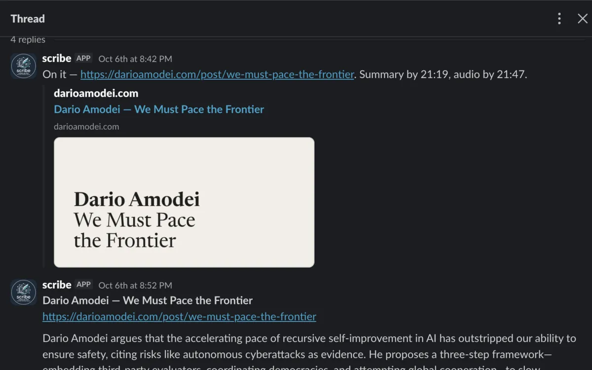
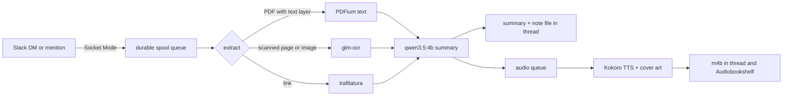

# scribe

A Slack bot: send it a link, PDF or image, and it replies in the thread with a short
summary, the full note as a file, and a narrated audiobook (m4b). The bot runs in a
Kubernetes cluster and uses only local, CPU-only models.



**Status:** in daily use. Deployed in-cluster as a container image; current release
v0.18.0. Developed on a self-hosted GitLab; this GitHub repo is a read-only mirror.

## How it works



1. A message arrives over Slack Socket Mode and is written to a spool on disk, then
   acknowledged immediately with an ETA for the summary and for the audio.
2. Text is extracted: a PDF's embedded text layer first, OCR (`glm-ocr` via Ollama) only
   for pages without one, and readable article text for links.
3. `qwen3.5:4b` produces the summary and the note. The TL;DR is posted in the thread,
   followed by the full note as PDF, Markdown or Word.
4. A second worker turns the note into a listening script, synthesizes it with Kokoro,
   draws a cover with SD-Turbo, packages a chaptered m4b with ffmpeg, and posts it to the
   thread and to an Audiobookshelf library.

## Engineering decisions

- **Read the text layer before OCR.** Most PDFs people send (slides, papers, exported
  documents) already carry selectable text. Reading it per page and OCRing only the pages
  that have none took a 39-page PDF from an estimated 15-25 minutes of CPU OCR to about
  half a second, and the text is exact instead of paraphrased by a vision model.
- **Two workers, joined by the spool.** Summarizing is bound by the single CPU Ollama
  host, which serves one request at a time, so it gets exactly one worker. Audio is bound
  by a different server, so it has its own. The hand-off is a record on disk, so a
  restart resumes both halves instead of dropping promised work.
- **Guard the OCR model's failure modes.** `glm-ocr` can generate forever on a sparse
  page (one title page ran past 14,000 tokens). Generation is capped at about 2x the
  densest measured page and OCR has its own timeout; a page that hits either is recorded
  as skipped with the reason, and the rest of the document proceeds.
- **Send `num_thread` on every request.** llama.cpp sizes its thread pool from the host's
  cores, not the container's CPU limit. Pinning it to the limit measured +73% generation
  speed (4.0 to 6.9 tokens/s) on `qwen3.5:4b`.
- **The ETA learns.** Each stage's estimate is multiplied by a correction factor learned
  from clean completions (an exponentially weighted mean of `log(actual/predicted)`), and
  quotes use the upper side of the spread so acks land early more often than late.
- **The listening script is rules, not a model.** An experiment on six real sources
  compared deterministic text cleanup with LLM repair prompts; every LLM variant added
  markup or dropped content, so there is no LLM pass. Reflowing PDF lines into paragraphs
  cut mid-sentence audio segment boundaries on a 62-page chapter from 33 of 57 to 2.
- **Nothing listens.** Socket Mode is an outbound WebSocket, so the pod needs no Service,
  Ingress or certificate. Slack scopes are limited to DMs and @-mentions.
- **Best-effort extras.** Audio, cover art and note export run after the summary is
  already in the thread; their failures cost that extra, never the job.

More detail: [docs/design-notes.md](docs/design-notes.md) (per-person settings, the
listening-script rules, ETA calibration, cover art, note delivery) and
[docs/measurements.md](docs/measurements.md) (OCR latency, DPI, thread tuning).

## Running it locally

Requires Python 3.12+, [uv](https://docs.astral.sh/uv/), and an
[Ollama](https://ollama.com) server with the two models pulled. Note export needs
`pandoc` (and weasyprint's Pango/Cairo libraries for PDF); audio needs `ffmpeg` plus a
Kokoro TTS server. The [Dockerfile](Dockerfile) lists the exact system packages.

```bash
git clone https://github.com/mekstromjr/scribe.git
cd scribe
uv sync

ollama pull glm-ocr
ollama pull qwen3.5:4b
uv run scribe health                      # which Ollama answered, and does it have the models

uv run scribe probe deck.pdf              # does this PDF have a text layer? (no model calls)
uv run scribe extract deck.pdf --per-page # method and timing for each page
uv run scribe note https://example.com/article
uv run scribe export --format pdf deck.pdf --out-dir ~/Downloads
uv run scribe listen --dry-run deck.pdf   # print the listening script, synthesize nothing

uv run scribe serve                       # the Slack bot; needs the two Slack tokens
```

Slack app creation and the two tokens are covered in [SLACK_SETUP.md](SLACK_SETUP.md),
using [manifest.json](manifest.json). In the cluster the image runs `scribe serve` with
the spool on a persistent volume.

## Testing and CI

```bash
uv run ruff check src/ tests/
uv run pytest -q          # 330 passed, 1 skipped; no network needed
```

Slack, Ollama, Kokoro and Audiobookshelf are stubbed in tests. The GitLab pipeline runs
secret detection, ruff and pytest on every branch, then builds the image with Kaniko on
`main` and on semver tags; the Kubernetes Deployment pins a release tag.

## Configuration

Every setting is an environment variable with the `SCRIBE_` prefix (also read from
`.env`); see [src/scribe/config.py](src/scribe/config.py) for the full list and the
reasoning behind each default.

| Variable | Default | Purpose |
|---|---|---|
| `SCRIBE_OLLAMA_HOST` | `http://localhost:11434` | Ollama server; the cluster Deployment sets the in-cluster address |
| `SCRIBE_OCR_MODEL` | `glm-ocr:latest` | Vision model for pages without a text layer |
| `SCRIBE_TEXT_MODEL` | `qwen3.5:4b` | Summarization model |
| `SCRIBE_NUM_THREAD` | `6` | Must equal the Ollama host's CPU allocation; the Deployment sets it |
| `SCRIBE_CONTEXT_TOKENS` | `32768` | Must match the server's `OLLAMA_CONTEXT_LENGTH` |
| `SCRIBE_MIN_PAGE_CHARS` | `24` | Below this, a page falls through to OCR |
| `SCRIBE_OCR_RENDER_DPI` | `150` | Main OCR cost lever |
| `SCRIBE_OCR_NUM_PREDICT` | `3000` | Generation cap per OCR page (runaway guard) |
| `SCRIBE_NOTE_FORMAT` | `pdf` | `pdf`, `md`, `docx` or `none`; `/scribeformat` overrides per person |
| `SCRIBE_TTS_HOST` | in-cluster Kokoro address | Kokoro TTS server for audio |
| `SCRIBE_COVER_HOST` | empty (covers off) | stable-diffusion.cpp `sd-server` for cover art |
| `SCRIBE_SPOOL_DIR` | `~/.local/state/scribe/queue` | Durable job queue; a persistent volume in the cluster |
| `SCRIBE_SLACK_BOT_TOKEN` | none | `xoxb-` token from installing the app |
| `SCRIBE_SLACK_APP_TOKEN` | none | `xapp-` token with `connections:write`, for Socket Mode |

## License

[MIT](LICENSE)
